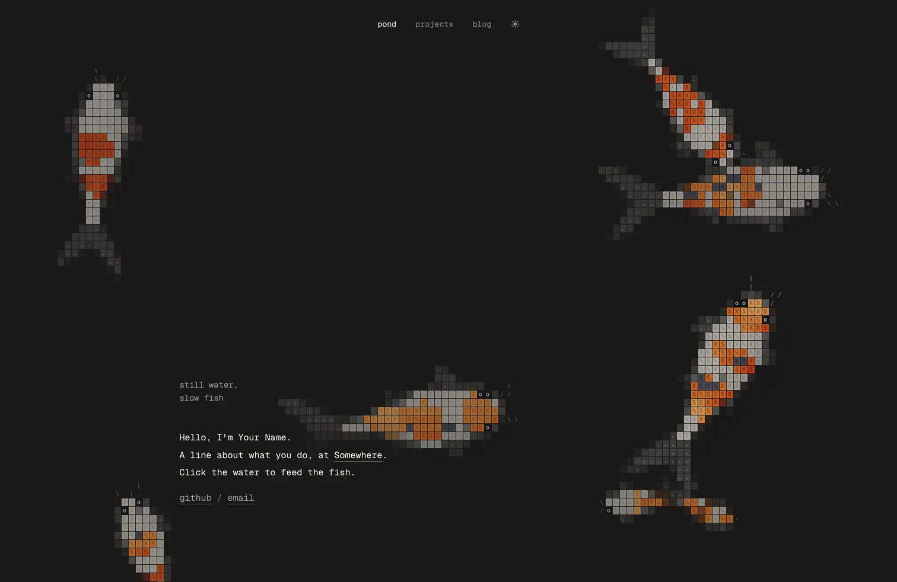

# ascii-pond

简体中文 | [English](README.en.md)

用字符拼成的锦鲤、鲨鱼、鸭子和乌龟在网页背后游来游去。小鱼只吃撒下的鱼食，鲨鱼、金枪鱼和鲈鱼会捕食它们。
鼠标移过去，鱼会游过来；点一下水面就撒鱼食。纯 JavaScript，不用构建，没有依赖。



## 快速上手

在页面里加两行：

```html
<script type="module" src="https://cdn.jsdelivr.net/gh/zhojielun/ascii-background@main/src/pond.js"></script>
<ascii-pond fixed></ascii-pond>
```

整个页面背后就有了池塘。只想放在某一块（比如文章头图），去掉 `fixed`，给它一个高度：

```html
<ascii-pond style="height: 320px"></ascii-pond>
```

给正文加上 `data-pond-avoid`，鱼就会绕着它游，游到文字底下时自动变淡，不挡阅读：

```html
<article data-pond-avoid>…</article>
```

不想依赖 CDN，就把 `src/` 目录复制到自己的站点，`src` 改成对应的路径。

## 用模板建站

`index.html` 是一个现成的单页小站：顶部导航、三个页面、深浅色切换。每次刷新都保留一条完整的
食物链：三种随机的小鱼各两条，一条鲨鱼加一种随机的大鱼（金枪鱼或鲈鱼），再随机加入两种其他生物。
Fork 本仓库，改掉标题和文字就能用。

本地预览要用 http 打开（ES 模块不支持直接双击打开文件）：

```sh
python3 -m http.server 8899
# 模板：     http://127.0.0.1:8899/
# 嵌入示例： http://127.0.0.1:8899/examples/embed.html
```

## 配置

### 标签属性

| 属性 | 作用 |
|---|---|
| `fixed` | 铺满整个窗口，作为页面背景 |
| `theme` | `auto`（跟随系统，默认）、`dark`、`light` |
| `count`、`young` | 每种生物几条大鱼、几条小鱼；锦鲤按池塘大小自动决定，其他生物默认各一只。上限：锦鲤 8 条，多数生物 4 只，鲨鱼、金枪鱼、鲈鱼各 2 条，青鳉鱼群 2 群 |
| `species` | 放哪些生物，逗号分隔，默认 `koi`；可用 `koi`、`duck`、`turtle`、`strider`、`frog`、`dragonfly`、`minnows`、`crayfish`、`newt`、`guppy`、`tetra`、`danio`、`platy`、`cory`、`shark`、`tuna`、`perch` |
| `avoid` | 鱼要绕开的元素（CSS 选择器），默认 `[data-pond-avoid]` |
| `no-feed` | 点击不撒鱼食 |

### 用 JavaScript 控制

```js
import { mount } from "./src/pond.js";

const pond = mount(document.body, {
  theme: "auto",
  species: [{ type: "koi", count: 4, young: 1 }],
  palette: { dark: { page: [16, 16, 20] } },  // 改成你的页面背景色
});

pond.feed(200, 150);            // 在 (200, 150) 撒鱼食
pond.setTheme(true, { x, y });  // 切到浅色，从 (x, y) 处向外铺开
pond.destroy();                 // 移除池塘
```

`mount` 的第一个参数可以是 `<canvas>`，也可以是任意元素（会在里面建一个 canvas）；
传 `document.body` 时自动铺满整页。返回 `{ pond, renderer, canvas, feed, setTheme, measure, destroy }`。

| 选项 | 默认 | 作用 |
|---|---|---|
| `species` | `["koi"]` | 同标签属性；也可以写 `{ type, count, young }`，或直接传物种对象 |
| `theme` | `"auto"` | 同标签属性；调用过 `setTheme()` 后不再跟随系统 |
| `avoid` | `"[data-pond-avoid]"` | 同标签属性；传 `null` 关闭 |
| `ignore` | 链接、按钮、输入框、`[data-pond-ignore]` | 点这些地方不撒鱼食 |
| `feed` | `true` | 点击撒鱼食 |
| `fixed` | 挂在 `<body>` 上时开启 | 铺满整个窗口 |
| `speed` | `1` | 游动速度；系统开了「减弱动态效果」时自动降到 0.2 倍 |
| `palette` | `{}` | 改配色，可用的键见 `src/pond.js` 里的 `DARK` |
| `onFrame` | | 每帧画完后调用 |

画布是透明的，字符方块的颜色会往 `bg` 上混，所以 `palette` 里的 `page` 和 `bg` 要设成接近页面背景的颜色，
不然池塘和页面会有色差。

### 已有的生物

| 名字 | 生物 | 说明 |
|---|---|---|
| `koi` | 锦鲤 | 默认物种，`src/koi.js` |
| `duck` | 鸭子 / 鸳鸯配色 | 浮在水面，会扎进水里抢食 |
| `turtle` | 乌龟 | 贴底慢游，偶尔上浮换气 |
| `strider` | 水黾 | 在水面滑行、急停，留下细小涟漪 |
| `frog` | 青蛙 | 蹲着、跳着换位置，落水会溅起水花 |
| `dragonfly` | 蜻蜓 | 悬停、冲刺，偶尔点水 |
| `minnows` | 青鳉鱼群 | 一个个体，画出来是一小群 |
| `crayfish` | 小龙虾 | 贴底横着找食，会挥钳子 |
| `newt` | 蝾螈 | 摆着尾巴在水草间慢游 |
| `guppy` | 孔雀鱼 | 小鱼，只吃鱼食；带斑点的大扇尾 |
| `tetra` | 霓虹灯鱼 | 小鱼，只吃鱼食；体侧一条亮蓝 |
| `danio` | 斑马鱼 | 小鱼，只吃鱼食；有条纹、游得快 |
| `platy` | 月光鱼 | 小鱼，只吃鱼食；橘红身，尾柄一块黑斑 |
| `cory` | 鼠鱼 | 小鱼，只吃鱼食；贴底觅食，嘴边两根须 |
| `shark` | 鲨鱼 | 能吞下的都捕食，吃完要消化 |
| `tuna` | 金枪鱼 | 游得很快，也会被大鲨鱼吃掉 |
| `perch` | 鲈鱼 | 小一号的捕食者，追小鱼，也会被鲨鱼吃掉 |

```html
<ascii-pond species="duck,turtle,strider" count="1" young="0"></ascii-pond>
```

### 食物链

`shark`、`tuna` 和 `perch` 会捕猎。它们追捕所有标记为猎物、且体型小于自身长度一定比例的已选生物，
所以大鲨鱼能吃金枪鱼、鲈鱼、小锦鲤和小鱼，金枪鱼能吃小鱼和最小的幼鲤，鲈鱼只吃小鱼和青鳉鱼群，
自己也会被鲨鱼吃掉。捕食者靠近时，锦鲤、青鳉鱼群和小鱼会逃跑。

引擎会保证一条完整的食物链：只要选进池塘的物种里有一种鱼，就会自动补上缺的一边——没有大鱼就补
一条鲨鱼，没有小鱼就补一条孔雀鱼。所以默认的 `koi` 实际会带上一条鲨鱼和一条孔雀鱼；只放鸭子、
乌龟这类没有鱼的池塘则原样不动。

捕到猎物后，捕食者会进入一段随机的饱食期（鲨鱼 20–36 秒，金枪鱼 16–30 秒，鲈鱼 12–24 秒）：
这段时间不再追活物，但照常吃鱼食。被吃掉的鱼会从同一补充池里随机选一种，在屏幕外补回来——
小鱼池：孔雀鱼、霓虹灯鱼、斑马鱼、月光鱼、鼠鱼、青鳉鱼群；大鱼池：鲨鱼、金枪鱼、鲈鱼——
所以池里的总数不变。每种生物仍有数量上限，补充不会把某一种越堆越多；池里只有一种时，补回来的就是它。

想一次看全整条食物链：

```html
<ascii-pond species="guppy,tetra,danio,shark,tuna,perch" count="2"></ascii-pond>
```

## 加新的生物

锦鲤在 `src/koi.js`，其他生物在 `src/animals.js`，鱼在 `src/fish.js`。每种生物是一个对象，
实现下面这些函数：

```js
{
  name: "jellyfish",
  colors: { dark: { … }, light: { … } },  // 它额外用到的颜色
  seed(pond) {},                           // 生成初始个体，放进 pond.creatures
  step(pond, creature, dt) {},             // 更新一个个体（每秒 120 次）
  draw(renderer, creature, time) {},       // 把它画进 renderer.grid
  prey: true,                              // 可选：可以被捕食
  predator: true,                          // 可选：会捕食别的生物
  pool: "small",                           // 可选：被吃后从哪个补充池里选
  limit: 4,                                // 可选：这一种最多补到几只
  spawn(pond, offscreen) {},               // 可选：补一只新个体，push 进 pond.creatures
  grow(pond) {},                           // 可选：窗口大小停下来 1.5 秒后调用，按新尺寸增减
  wake(renderer, creature) {},             // 可选：搅出水波，用 renderer.stir(x, y, amount)
  splash(pond, pellet) {},                 // 可选：鱼食刚落水
  floating(pond, pellet) {},               // 可选：鱼食漂在水面时，每次更新都调用
}
```

每个个体要带上 `species`（指向这个对象）和 `depth`（0 是水底，1 是水面，越深越先画）；
给个体设 `gone = true`，这一步结束后就把它移除。
写好后用 `SPECIES.jellyfish = (config) => ({ … })` 注册，或者直接传给 `species` 选项。

`prey` 表示可以被吃，`predator` 表示会被别的生物当成威胁：内置的捕食者会追标记为 `prey`
且体型够小的生物，锦鲤、青鳉鱼群和小鱼会躲开体型更大的 `predator`。自己写捕食者时，追捕和
进食仍要在 `step` 里实现。可被吃的生物要提供 `spawn(pond, offscreen)`，把新个体 push 进
`pond.creatures`；`offscreen` 为 true 时从池塘外开始。`pool` 相同的生物共用补充池，`limit`
防止反复补充把某一种堆得太多。

## 实现原理

- 模拟固定每秒算 120 次，60 Hz 和 144 Hz 的屏幕上看到的动作一样。
- 每条锦鲤是一根 20 节的「脊椎」，跟着头走。屏幕上每个格子先判断落在身体、鳍、眼睛还是须上，
  再画成一个带字符的方块。花纹贴在身体上，鱼一弯，花纹跟着弯。
- 每条鱼性格不同，在巡游、滑行、探索、休息、上浮、跟着别的鱼之间随机切换，偶尔突然冲一下。
  饿的鱼会抢食，吃饱的爱理不理。
- 偶尔有鱼无缘无故受惊窜开，旁边的鱼跟着一抖。手指划过水面会留下水波。
- 鲨鱼、金枪鱼或鲈鱼发现更小的鱼时会预判它的去向，加速、张嘴冲刺；咬中时溅起水波和咬痕闪光。
  小鱼会 C 形急转散开，捕食者则游开消化。只有捕食者吃动物，能被吃的有小鱼、锦鲤、青鳉鱼群，
  还有鲈鱼。
- 鸭子浮水扎猛子，乌龟贴底慢游、偶尔上浮，水黾在水面滑行，青蛙一跳一跳，蜻蜓悬停后突然冲刺，
  鱼群绕着中心打转，小龙虾趴在池底挥钳子，蝾螈摆着尾巴慢游；鼠鱼贴着池底、探着胡须找食。
- 系统开了「减弱动态效果」时鱼游得更慢，撒鱼食照常；高对比度（强制颜色）模式下不显示池塘。

## 文件

| 文件 | 内容 |
|---|---|
| `src/pond.js` | 引擎：池塘、水面、渲染、主题切换、`mount()`、`<ascii-pond>` |
| `src/koi.js` | 锦鲤 |
| `src/animals.js` | 鸭子、乌龟、水黾、青蛙、蜻蜓、鱼群、小龙虾、蝾螈 |
| `src/fish.js` | 鲨鱼、金枪鱼、鲈鱼和小鱼；捕猎、消化与补充 |
| `src/util.js` | 公用的数学函数 |
| `index.html` | 单页模板 |
| `favicon.svg` | 模板的网页图标 |
| `demo.webp` | README 里的演示动图 |
| `examples/embed.html` | 嵌入示例 |
| `fonts/` | 模板用的 Geist Mono 字体 |

浏览器要支持 ES 模块、自定义元素和 `ResizeObserver`，模板还用到 CSS `color-mix()`。近几年的主流浏览器都没问题。

## 致谢

感谢 [stqfdyr/ascii-pond](https://github.com/stqfdyr/ascii-pond) 提供的池塘引擎，以及 [stackedlol/ascii-sharks](https://github.com/stackedlol/ascii-sharks) 带来的灵感。

## 许可证

MIT，见 [`LICENSE`](LICENSE)。附带的 Geist Mono 字体是 SIL OFL 1.1 许可，见 [`fonts/GEIST-LICENSE`](fonts/GEIST-LICENSE)。
